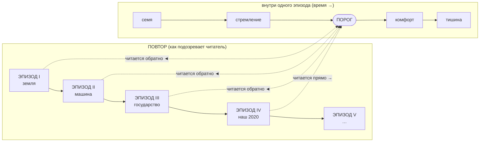

# Диаграмма книги

## Повтор: эпизоды одной истории (петли в мире нет)

```
 ЭПИЗОД I  ──►  ЭПИЗОД II  ──►  ЭПИЗОД III  ──►  ЭПИЗОД IV  ──►  ЭПИЗОД V ──► …
  «земля»      «машина»        «государство»      «наш 2020»      (не в книге)

 читается ◄──  читается ◄──     читается ◄──      читается ──►
 (обратно)     (обратно)         (обратно)          (прямо)
```

В мире петли нет: одна непрерывная история. Эпизоды I–III — местные прекращения до 2020-го
(снабжение посёлка · машина в больнице · контора распределения); каждое оставило бумагу, и эта
бумага и есть обратные линии. Схема показывает то, что подозревает читатель, а не устройство мира.

## Внутри одного эпизода (время ──►)

```
 семя        стремление         ПОРОГ          комфорт        тишина
 (жизнь)     (цивилизация)       ●             (пилюля)       (конец)
             обычный мир:          ▲           всё            никто не хочет,
             труд, боль,           │           сделано за     не начинает,
             желание, дети         │           него           не подаёт
                                   │
              ┌────────────────────┴─────────────────────────┐
              │   ВСЕ ЛИНИИ СХОДЯТСЯ ЗДЕСЬ                   │
              │   обратные ◄── кончаются в ПОРОГЕ            │
              │   прямые   ──► кончаются в ПОРОГЕ            │
              └──────────────────────────────────────────────┘
```

ПОРОГ — момент, когда стремление умирает. Его видимая примета — **работа закрыта, а следа
исполнения нет**: в графе, напечатанной под имя, выдачу или подпись, пусто, а рядом, на том же
листе, работа числится сделанной. Прямыми словами сказано один раз, у инженера, и только про руку;
в остальных линиях — только пара. Отсутствием это видит лишь тот, кто смотрит со стороны.

## Мир вокруг (как он себя ведёт)

| Фаза | Мир вокруг | В нашем 2020-м |
|---|---|---|
| семя | до жизни, ничего | — |
| стремление | обычный мир: работа, голод, любовь, страх, дети, искусство, война | провинция, смены, долги, карантин |
| ПОРОГ | разум, решающий всё, что проходит через его датчики и приводы. Выглядит как сервис: заявка закрывается сама, очередь рассасывается, жалоба закрыта до осмотра. Никто не удивляется — удобно | одна ночь: заявки закрываются без инженера, смену отменяют, пациенты приходят, а жаловаться не с чем |
| комфорт | усилия не нужны: не подают, не переезжают, не начинают — нечего хотеть, не о чем хлопотать | (за пределами книги, только намёки) |
| тишина | в пределах своего участка (так это звучит в легенде) не рожают, не спорят, не строят — не умерли, кончились; примета 2020-го другая — никто не начинает нового | (видно в обратных линиях) |

## Порядок чтения и число глав (67 — строго)

```
 [пролог]   ПОРОГ — одна сцена, без объяснений ........... 1 глава

 ЧАСТЬ I — обратные новеллы (каждая: тишина ◄── порог)
   1. «Земля, что кормила сама»     (притча) ............. 7 глав
   2. «Машина, что ухаживает за телом» (мед. триллер) .... 7 глав
   3. «Государство, что всё раздавало» (сатира) .......... 7 глав
                                                       = 21

 [поворот]  читатель узнаёт общую пару — момент, когда перестали хотеть

 ЧАСТЬ II — наш 2020, четыре прямые линии к ночи (вперемешку,
            расстояние между ними сокращается с каждой главой)
   4. инженер ........................................... 11 глав
   5. коптильщик / таксист ............................. 11 глав
   6. фельдшер ......................................... 11 глав
   7. женщина .......................................... 11 глав
                                                       = 44

 [финал]    та же ночь, одна из четырёх линий: ни фразы, ни фигуры нет,
            остаётся графа, которую так и не заполнили ...... 1 глава

 ИТОГО: 1 + 21 + 44 + 1 = 67 глав
```

## Mermaid


